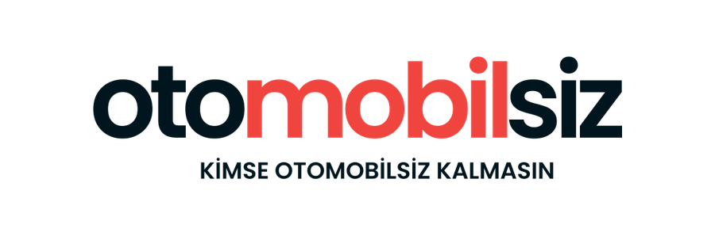

 

<h1>Merhaba, ben Berk Can 👋</h1>

<h3>Fikirleri web, mobil ve masaüstünde çalışan ürünlere dönüştürüyorum.</h3>

  Junior yazılım geliştiriciyim. API'ler, web arayüzleri ve mobil uygulamalar geliştirerek her gün yeni şeyler öğreniyorum. 
  Şu sıralar gayrimenkul ve otomotiv için kendi ürünlerim <b>Emlaksız</b> ve <b>otomobilsiz</b>'i büyütüyorum.

 

&nbsp;

 

<table>
<tr>
<td>

<h3>🙋 Kısaca ben</h3>

- 🚀 &nbsp;Kendi projelerimde arayüzden backend'e, mobil uygulamadan canlıya almaya kadar her adımı öğrenerek ilerliyorum.
- 🧱 &nbsp;Backend'de **C# / ASP.NET Core** ve **NestJS**, arayüzde **Next.js / React**, mobilde **React Native** ve **Flutter** kullanıyorum.
- 📍 &nbsp;Harita tabanlı uygulamalar, gerçek zamanlı mesajlaşma ve fiyat analizi en sevdiğim problem alanları.
- 🤝 &nbsp;Yazılım projeleri ve iş birliği fırsatları için her zaman konuşmaya açığım.

</td>
</tr>
</table>

 

<h2 align="center">Öne Çıkan Projeler</h2>

<table>
<tr>
<td width="50%" valign="top" align="center">

 

<a href="https://github.com/berkcanka/emlaksiz">
  <picture>
    <source media="(prefers-color-scheme: dark)" srcset="https://raw.githubusercontent.com/berkcanka/emlaksiz/main/.github/assets/logo-dark.png">
    
  </picture>
</a>

<h4>Kimse emlaksız kalmasın.</h4>

Emlakçılar ve yatırımcılar için harita odaklı emlak platformu. Ortak portföy, tek tıkla sanal drone klibi, 360° tur ve ekspertiz raporu tek uygulamada.

  

  

  

</td>
<td width="50%" valign="top" align="center">

 

<a href="https://github.com/berkcanka/otomobilsiz">
  <picture>
    <source media="(prefers-color-scheme: dark)" srcset=".github/assets/otomobilsiz-logo-dark.png">
    
  </picture>
</a>

<h4>Aradığın aracı yaz. Kelepir düşünce haberin olsun.</h4>

İkinci el araç ilanlarını emsalleriyle kıyaslayan ve fiyat piyasanın altına indiği anda seni uyaran akıllı fiyat alarmı.

  

  

  

</td>
</tr>
</table>

 

<h2 align="center">Teknolojiler</h2>

<table>
<tr>
<td align="right"><b>Backend</b></td>
<td></td>
</tr>
<tr>
<td align="right"><b>Web</b></td>
<td></td>
</tr>
<tr>
<td align="right"><b>Mobil</b></td>
<td></td>
</tr>
<tr>
<td align="right"><b>Veri ve araçlar</b></td>
<td></td>
</tr>
</table>

 

---

 

<h3>Birlikte bir şey geliştirelim mi?</h3>

Yazılım projeleri ve iş birliği fırsatları için LinkedIn'den yazabilirsin.

  

  

Yeni fikirler, yeni projeler, sürekli gelişim.

